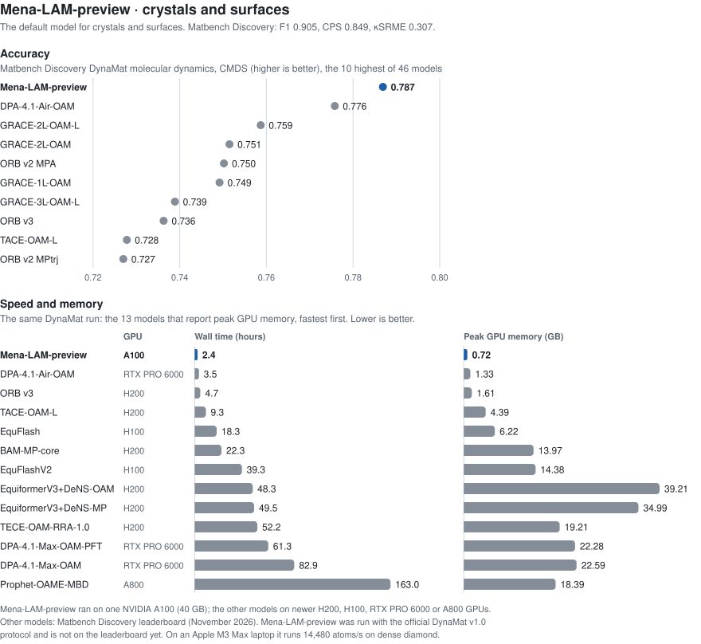
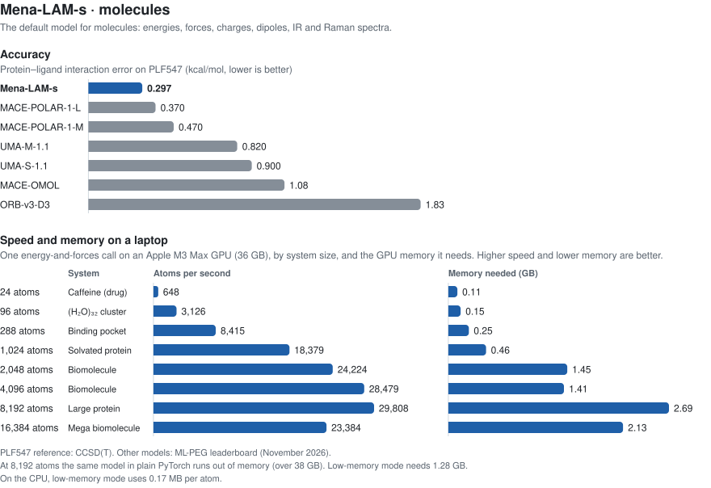

# Mena-Lab

> I am an ML student. I used my personal resources (money and time) and ran multiple iterations to reach this level. I hope this is in some ways beneficial to the field and to the community. Give me your feedback.

Mena-Lab runs fast machine-learned interatomic potentials for molecules, crystals, and surfaces on your own computer (Windows, macOS, Linux; CPU, NVIDIA GPU, or Apple Silicon). It includes a local web app, a command-line interface, and an ASE-compatible Python API.

You can relax geometries and unit cells, run NVE/NVT/NPT molecular dynamics, compute vibrational frequencies with IR and Raman intensities, calculate crystal phonon bands and density of states, and find NEB reaction barriers. Before running a job, the app estimates runtime and memory so you know what fits on your machine.

It ships three compact checkpoints (26–35 MB) that download automatically on first use and are checked by SHA-256:
- Mena-LAM-6 (`lam6-v1`), used by default for crystals and surfaces, with optional electronic descriptors (HOMO–LUMO gap, radical character, steric overlap, and spin exchange).
- Mena-LAM-s (`lam5-v1`), used by default for molecules, biomolecules, partial charges, dipoles, polarizabilities, and IR/Raman spectra.
- Mena-LAM-preview (`lam-400k`), an earlier materials checkpoint kept for comparison.

Everything runs on standard PyTorch with GPU acceleration on Apple Silicon and NVIDIA GPUs, and falls back cleanly to CPU without requiring a local CUDA compiler.

## Install

```bash
pip install git+https://github.com/iatecoding/mena-lab
```

Requires Python 3.10 or newer. On an NVIDIA GPU, install the CUDA build of [PyTorch](https://pytorch.org/get-started/locally/) first.

## Quick start

Launch the local web interface:

```bash
mena webapp
```

Drop in a CIF, XYZ, or POSCAR file (or enter a SMILES string or pick a built-in example), choose a calculation, and run. Every completed job saves plots, an interactive 3D structure view, output files, and the CLI/Python/JSON recipe to reproduce it.

From the command line:

```bash
mena sp caffeine --explain                    # energy, forces, charges, dipole & electronic descriptors
mena relax structure.cif --fmax 0.01          # relax atomic positions and unit cell
mena md water_box.extxyz --temperature 300 --steps 10000
mena vib aspirin.xyz                          # harmonic frequencies, IR and Raman spectra
mena phonons si --supercell 3                 # phonon band structure and DOS
mena neb reactant.xyz product.xyz --images 9  # reaction barrier
mena <task> --help                            # list all options
```

Input structures can be a file path, `smiles:CCO`, or a built-in example name. Each run saves a `job.json` you can re-run later with `mena run job.json`.

From Python (as an [ASE](https://wiki.fysik.dtu.dk/ase/) calculator or one-line helper):

```python
from mena_app import calculator, singlepoint

res = singlepoint("caffeine", device="auto")      # uses lam5-v1 for molecules, lam6-v1 for crystals/surfaces
atoms.calc = calculator("lam6-v1")                # or "lam5-v1" / "lam-400k"; device="cuda" / "mps" / "cpu"
```

## Models

| Model | Default for | Accuracy & capabilities |
|---|---|---|
| Mena-LAM-6 (`lam6-v1`) | Crystals & surfaces | Matbench Discovery CPS 0.874, F1 0.904, thermal conductivity κ<sub>SRME</sub> 0.182 (0/103 imaginary modes); OC20/OC25/MAD-1.6 catalysis & OMC25 molecular crystals; OMol25 val 2.00 kcal/mol E, 0.40 kcal/mol/Å F; electronic descriptors via `--explain` |
| Mena-LAM-s (`lam5-v1`) | Molecules | OMol25 held-out 1.64 kcal/mol E, 0.34 kcal/mol/Å F; PLF547 protein–ligand MAE 0.297 kcal/mol vs. CCSD(T); TorsionNet500 0.205 kcal/mol; partial charges, dipole, polarizability, IR & Raman spectra |
| Mena-LAM-preview (`lam-400k`) | Kept for comparison | Earlier materials checkpoint; Matbench Discovery F1 0.905, CPS 0.849, κ<sub>SRME</sub> 0.307; DynaMat MD CMDS 0.787 |

By default, Mena-Lab picks `lam6-v1` for periodic structures and `lam5-v1` for molecules. You can override the default in Settings or from the CLI:

```bash
mena models default crystal lam5-v1   # "auto" restores the default (lam6-v1)
```

Total energies are referenced per model and functional (level of theory), so always compare energies computed with the same model and functional. When registering custom checkpoints with `mena models add`, only load files you trust.

## Practical tips for SMILES and MD

- Relax SMILES geometries first: a SMILES string generates one quick 3D force-field conformer, not a DFT minimum or conformer ensemble. Run `mena relax` before comparing energies or dipoles, and turn on "Relax first" (`--prerelax`) before starting MD from SMILES so initial steric strain does not heat up the trajectory.
- Choosing an MD time step and thermostat: `1.0 fs` works well for relaxed organics around `300 K`; drop to `0.5 fs` above `500 K` or for stiff/strained geometries; use `2.0 fs` only for heavy-atom systems without hydrogen. The default Langevin friction (`0.01 /fs`, τ = 100 fs) is suited for production NVT; raising it to `0.05–0.1 /fs` helps damp initial strain during equilibration. Use NVE to check energy conservation.
- Charge and spin multiplicity: formal charges and simple organic radicals (`[O-]`, `[NH4+]`, `[CH3]`) are inferred from SMILES, but set charge and spin multiplicity explicitly for diradicals (such as triplet O<sub>2</sub>), carbenes, or transition-metal complexes. Multi-fragment SMILES (`A.B`) are simulated in vacuum without a confining box.
- Picking a model on molecules: keep Auto (`lam5-v1`) for the lowest energy/force errors and IR/Raman spectra; select `lam6-v1` explicitly on molecules if you want the HOMO–LUMO gap, unpaired-electron index, or steric overlap readout (`--explain`).

## Benchmarks

<picture>
  <source media="(prefers-color-scheme: dark)" srcset="docs/materials-dark.svg">
  
</picture>

<picture>
  <source media="(prefers-color-scheme: dark)" srcset="docs/molecules-dark.svg">
  
</picture>

Open the Performance tab in the web app for the full benchmark suite (including CPS vs. training compute, dense diamond scaling, and live speed/memory tests on your own hardware).

## License

Code: [Apache-2.0](LICENSE). Model weights: [CC BY 4.0](LICENSE-WEIGHTS). Third-party material and training data: [NOTICE](NOTICE).

## Citation

If you use Mena-Lab or any of the Mena-LAM weights in your work, please cite this repository and specify the model (`Mena-LAM-6`, `Mena-LAM-s`, or `Mena-LAM-preview`) and level of theory used (see `CITATION.cff`).
