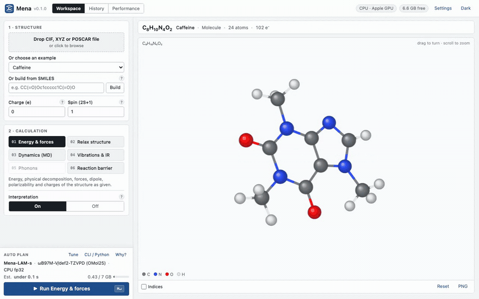

# Mena-Lab

> I am a student, I used my personal resources (money and time) and ran multiple iterations to reach this level. I hope this is in some ways beneficial to the field and to the community. Keep an open minded and proactive approach testing this, open to feedbacks. Leave a star if you liked this

Mena-Lab runs fast machine-learned interatomic potentials for molecules, crystals, and surfaces on your own computer (Windows, macOS, Linux; CPU, NVIDIA GPU, or Apple Silicon). It includes a local web app, a command-line interface, and an ASE-compatible Python API.

You can relax geometries and unit cells, run NVE/NVT/NPT molecular dynamics, compute vibrational frequencies with IR and Raman intensities, calculate crystal phonon bands and density of states, and find NEB reaction barriers. Before running a job, the app estimates runtime and memory so you know what fits on your machine.

It ships three compact checkpoints (26–35 MB) that download automatically on first use and are verified by SHA-256:
- **Mena-LAM-6 (`lam6-v1`)** — default for crystals and surfaces; multi-functional (PBE, PBE+U, r²SCAN, RPBE, PBE+D3) with optional electronic descriptors (HOMO–LUMO gap, unpaired electrons, steric overlap).
- **Mena-LAM-s (`lam5-v1`)** — default for molecules and biomolecules; predicts partial charges, dipole, polarizability, and IR/Raman spectra.
- **Mena-LAM-preview (`lam-400k`)** — earlier materials checkpoint kept for comparison.

Everything runs on standard PyTorch with GPU acceleration on Apple Silicon and NVIDIA GPUs, and falls back cleanly to CPU without requiring a local CUDA compiler.



## Install & update

```bash
pip install https://github.com/iatecoding/mena-lab/archive/refs/heads/main.zip
```

To update an existing install to the latest release (keeps your downloaded model weights, history, and settings intact):

```bash
pip install --upgrade https://github.com/iatecoding/mena-lab/archive/refs/heads/main.zip
```

Requires Python 3.10 or newer. On an NVIDIA GPU, install the CUDA build of [PyTorch](https://pytorch.org/get-started/locally/) first.

## Quick start

Launch the local web interface:

```bash
mena webapp
```

Drop in a CIF, XYZ, or POSCAR file (or enter a SMILES string or pick a built-in example), choose a calculation, and run. Every completed job saves plots, an interactive 3D structure view, output files, and the CLI/Python/JSON recipe to reproduce it.

From the command line:

```bash
mena sp caffeine --explain                    # energy, forces, charges, dipole & electronic descriptors
mena relax structure.cif --fmax 0.01          # relax atomic positions and unit cell
mena relax structure.cif --lot matpes_r2scan  # run with a specific level of theory (r²SCAN)
mena md water_box.extxyz --temperature 300 --steps 10000
mena vib aspirin.xyz                          # harmonic frequencies, IR and Raman spectra
mena phonons si --supercell 3                 # phonon band structure and DOS
mena neb reactant.xyz product.xyz --images 9  # reaction barrier
mena <task> --help                            # list all options
```

Input structures can be a file path, `smiles:CCO`, or a built-in example name. Each run saves a `job.json` you can re-run later with `mena run job.json`.

From Python (as an [ASE](https://wiki.fysik.dtu.dk/ase/) calculator or one-line helper):

```python
from mena_app import calculator, singlepoint

res = singlepoint("caffeine", device="auto")           # uses lam5-v1 for molecules, lam6-v1 for crystals/surfaces
atoms.calc = calculator("lam6-v1", lot="matpes_r2scan")  # or lot="auto" / "mp_pbe" / "oc20_rpbe" / "omol_wb97mv"
```

## Models

| Model | Default for | Highlights |
|---|---|---|
| **Mena-LAM-6 (`lam6-v1`)** | Crystals & surfaces | Matbench Discovery CPS `0.874`, F1 `0.904`, κ<sub>SRME</sub> `0.182` (0/103 imaginary modes); X23 molecular crystals `2.28%` volume MAPE (`1.64 kcal/mol`); OC20 catalysis & OMC25; electronic descriptors via `--explain` |
| **Mena-LAM-s (`lam5-v1`)** | Molecules | OMol25 held-out `1.64 kcal/mol` E, `0.34 kcal/mol/Å` F; PLF547 protein–ligand `0.297 kcal/mol` vs. CCSD(T); X23 molecular crystals `1.40 kcal/mol` (`2.67%` Vol MAPE) via 3D periodic SPME; TorsionNet500 `0.205 kcal/mol`; charges, dipole, polarizability, IR & Raman |
| **Mena-LAM-preview (`lam-400k`)** | Comparison | Earlier materials checkpoint; Matbench Discovery F1 `0.905`, CPS `0.849`, κ<sub>SRME</sub> `0.307`; DynaMat MD CMDS `0.787` |

You can change the default model per domain in **Settings** or from the CLI:

```bash
mena models default crystal lam5-v1   # "auto" restores the default (lam6-v1)
```

When registering custom checkpoints with `mena models add`, only load files you trust.

## Levels of theory

Each Mena-LAM checkpoint is trained across multiple DFT functionals and datasets, so a single model can reproduce different **levels of theory (LoT)** without switching weights.

By default (`lot="auto"`), Mena-Lab chooses the functional from your structure:
- **Molecules:** `omol_wb97mv` (ωB97M-V/def2-TZVPD)
- **Bulk crystals:** `mp_pbe` or `mp_pbeU` (Materials Project PBE with MP2020 `+U` rules)
- **Surfaces / slabs:** `oc20_rpbe` (RPBE for metal catalysis) or `PBE+U` for transition-metal oxide slabs

To pick another functional explicitly:
- **Web app:** click **Tune** in the bottom plan bar and select **Level of theory** (filtered automatically to functionals valid for your structure and model).
- **CLI:** pass `--lot <name>` (e.g. `--lot matpes_r2scan`, `--lot oc20_rpbe`, `--lot omc25_pbe`; short aliases like `r2scan`, `rpbe`, `omc25`, `spice` also work).
- **Python:** pass `lot="..."` to `calculator(...)` or `singlepoint(...)`.

| Domain | Level of theory (`--lot`) | Reference DFT / dataset | Models |
|---|---|---|---|
| **Bulk crystals** | `mp_pbe`, `mp_pbeU` | PBE / PBE+U (Materials Project, PBE\_52) | `lam6-v1`, `lam5-v1`, `lam-400k` |
| | `omat_pbe`, `omat_pbeU` | PBE / PBE+U (OMat24, PBE\_54) | `lam6-v1`, `lam-400k` |
| | `matpes_pbe`, `matpes_r2scan` | PBE / r²SCAN (MatPES, PBE\_64) | `lam6-v1`, `lam-400k` (`r2scan` also `lam5-v1`) |
| **Surfaces & catalysis** | `oc20_rpbe` | RPBE (OC20 catalysis) | `lam6-v1`, `lam5-v1` |
| | `oc22_pbeU` | PBE+U (OC22 oxide catalysis) | `lam5-v1` |
| **Molecular crystals & liquids** | `omc25_pbe` | PBE+D3 (OMC25) | `lam6-v1` |
| **Molecules & 3D periodic molecular boxes** | `omol_wb97mv` | ωB97M-V/def2-TZVPD (OMol25; 3D SPME under PBC) | `lam5-v1`, `lam6-v1`, `lam-400k` |
| | `spice_wb97md3` | ωB97M-D3(BJ)/def2-TZVPPD (SPICE 2; 3D SPME under PBC) | `lam6-v1` |

> [!NOTE]
> Total energies are referenced per model and level of theory, so only compare energies computed with the same model and `--lot`. Molecular levels of theory (`omol_wb97mv`, `spice_wb97md3`) support both isolated molecules and **3D periodic boxes** (molecular crystals, liquid water, solvated biomolecules) via 3D SPME electrostatics with automatic per-molecule fragmentation for neutral closed-shell systems; periodic boxes containing explicit counterions (e.g. Na⁺/Cl⁻) should pass per-molecule `frag_id` and `frag_charge` in Python (`atoms.arrays["frag_id"]`, `atoms.info["frag_charge"]`). Periodic crystal/surface functionals are for periodic structures only.

## Practical tips for SMILES and MD

- **Relax SMILES geometries first:** a SMILES string generates one quick 3D force-field conformer, not a DFT minimum. Run `mena relax` before comparing energies or dipoles, and enable **Relax first** (`--prerelax`) before MD from SMILES so steric strain does not heat up the trajectory.
- **MD time step and thermostat:** `1.0 fs` works well for relaxed organics around `300 K`; drop to `0.5 fs` above `500 K` or for stiff/strained structures; use `2.0 fs` only for heavy-atom systems without hydrogen. Default Langevin friction (`0.01 /fs`, τ = 100 fs) suits production NVT; raise to `0.05–0.1 /fs` during equilibration. Use NVE to verify energy conservation.
- **Charge and spin multiplicity:** formal charges and simple organic radicals (`[O-]`, `[NH4+]`, `[CH3]`) are inferred from SMILES, but set charge and spin multiplicity explicitly for diradicals (e.g. triplet O<sub>2</sub>), carbenes, or transition-metal complexes. Multi-fragment SMILES (`A.B`) run in vacuum without a confining box.
- **Model choice on molecules:** keep **Auto** (`lam5-v1`) for the lowest energy/force errors and IR/Raman spectra; pick `lam6-v1` in **Tune** if you want electronic descriptors (`--explain`: HOMO–LUMO gap, unpaired-electron index, steric overlap).

## Benchmarks

<picture>
  <source media="(prefers-color-scheme: dark)" srcset="docs/materials-dark.svg">
  
</picture>

<picture>
  <source media="(prefers-color-scheme: dark)" srcset="docs/molecules-dark.svg">
  
</picture>

Open the Performance tab in the web app for the full benchmark suite (including CPS vs. training compute, dense diamond scaling, and live speed/memory tests on your own hardware).

## License

Code: [Apache-2.0](LICENSE). Model weights: [CC BY 4.0](LICENSE-WEIGHTS). Third-party material and training data: [NOTICE](NOTICE).

## Citation

If you use Mena-Lab or any of the Mena-LAM weights in your work, please cite this repository and specify the model (`Mena-LAM-6`, `Mena-LAM-s`, or `Mena-LAM-preview`) and level of theory used (see `CITATION.cff`).
